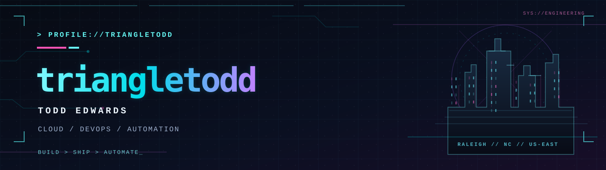

<!-- GitHub profile README for github.com/triangletodd -->

<p align="center">
  
</p>

<p align="center">
  <a href="https://rte.dev"></a>
  <a href="https://triangletodd.com"></a>
  <a href="https://mtn.cc"></a>
</p>

### `> whoami`

**Todd Edwards.** Cloud consultant by title, engineer by instinct.

I work at the intersection of **software engineering, Linux infrastructure, cloud platforms, and DevOps**. I've spent 15+ years building systems, automating delivery pipelines, and making complicated infrastructure easier to operate.

I like practical tools, reproducible environments, and solutions that survive contact with production. The best automation is the kind nobody has to think about.

```text
$ cat /etc/profile.d/engineering.conf
ROLE=Cloud / Solutions Architect
FOCUS=Platform Engineering + Developer Experience
DEFAULT_MODE=Build > Ship > Automate
LOCATION=Raleigh, NC
```

---

### `> cat /proc/stack`

| Layer | Tools & technologies |
|:--|:--|
| **Systems** | Linux · Containers · Kubernetes · Docker |
| **Cloud** | AWS · Azure · IBM Cloud |
| **Delivery** | Jenkins · GitHub Actions · GitLab CI/CD · Git |
| **Automation** | Python · Bash · Infrastructure automation · APIs |
| **Observability** | Prometheus · Grafana · Platform operations |
| **Exploration** | Local LLM inference · MCP · Agent orchestration |

<p>
  
  
  
  
  
  
</p>

---

### `> ls ~/projects --featured`

| Repository | Transmission |
|:--|:--|
| **[web-search-mcp](https://github.com/triangletodd/web-search-mcp)** | Locally hosted web-search MCP server for local LLM workflows. |
| **[asdf-ibmcloud](https://github.com/triangletodd/asdf-ibmcloud)** | IBM Cloud CLI version management via an `asdf` plugin. |
| **[probot-labeler](https://github.com/triangletodd/probot-labeler)** | GitHub issue and PR labeling using titles and slash commands. |
| **[dotfiles](https://github.com/triangletodd/dotfiles)** | Personal development environment and configuration. |

<details>
<summary><strong><code>+ more from the archive</code></strong></summary>
<br />

- [homelab](https://github.com/triangletodd/homelab) — home infrastructure and experiments
- [playbook-homelab](https://github.com/triangletodd/playbook-homelab) — homelab automation playbooks
- [rte.dev](https://github.com/triangletodd/rte.dev) — personal site

</details>

---

### `> tail -f /var/log/now-building`

```text
[01] Platform engineering and CI/CD that developers actually want to use
[02] Local LLM infrastructure: llama.cpp, inference, and multi-agent workflows
[03] Open tooling, automation, and a homelab that never stays finished
```

<p align="center">
  <code>NO MAGIC. JUST SYSTEMS.</code>
  <br />
  <sub>© Todd Edwards · <a href="https://github.com/triangletodd">github.com/triangletodd</a> · // END TRANSMISSION</sub>
</p>
